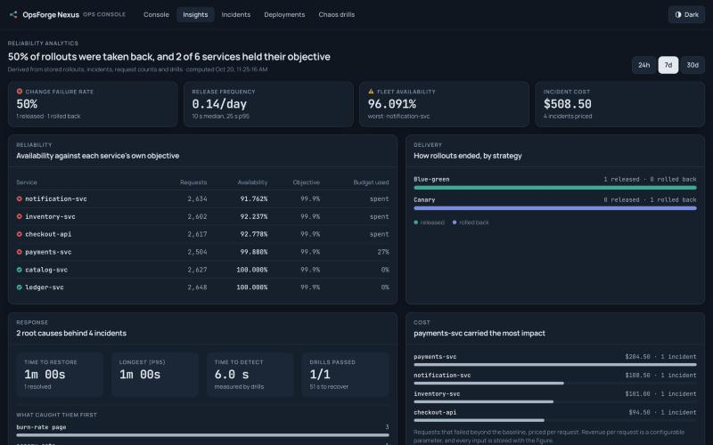
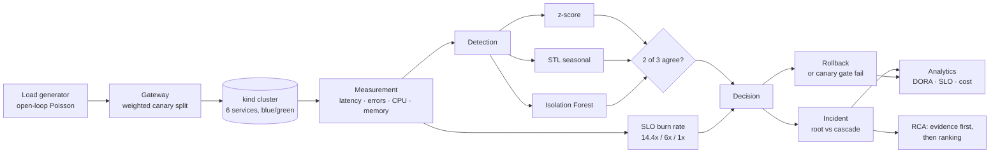
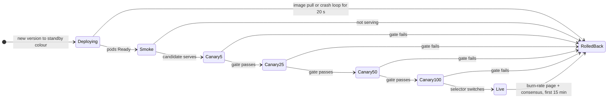
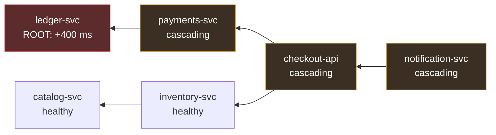
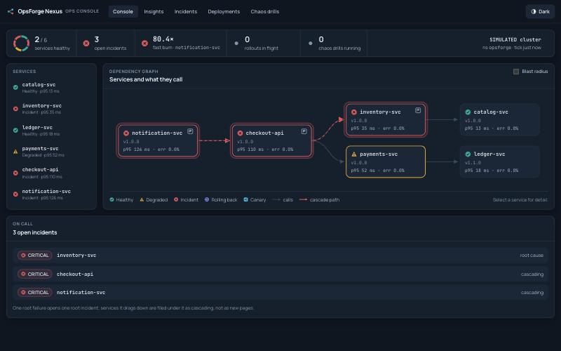

<div align="center">

# OpsForge Nexus

**Reliability analytics and release decisioning for a live microservice fleet.**

Measures six services on a real Kubernetes cluster, decides whether each release is safe,
prices what every incident cost, and proves its own detection works by breaking things on purpose.

[](https://github.com/IshaanS0112/OpsForge-Nexus/actions/workflows/ci.yml)
[](LICENSE)
[](https://www.python.org)
[](https://react.dev)
[](#tests)

[Quick start](#quick-start) · [What it answers](#what-it-answers) · [How it decides](#how-it-decides) · [Measured results](#measured-results) · [Methods](docs/methods.md) · [Architecture](docs/architecture.md)

</div>

---

<div align="center">

</div>

## What it answers

Four questions, each computed from stored measurements:

| Question | Computed from | Output |
|---|---|---|
| Are we shipping safely? | Every rollout's recorded state history | Release frequency, change failure rate, rollout duration |
| Are we meeting our promises? | Request counts written each 5-second tick | Availability per service vs its SLO, error budget consumed |
| How fast do we react? | Incidents, plus drills that know the true fault onset | Time to detect and restore, what caught each incident first |
| What did it cost? | Measured bad requests × revenue per request | Priced impact per incident and per service, inputs stored |

`GET /analytics/summary?days=7` returns all four. The Insights screen renders that call, and
`scripts/report.py` prints it for a terminal:

```console
$ python3 scripts/report.py --days 1

33% OF ROLLOUTS WERE TAKEN BACK AND 2 OF 6 SERVICES HELD THEIR OBJECTIVE.

DELIVERY
  Releases              2 (2.0/day)
  Rolled back           1
  Change failure rate   33%
  Rollout duration      10.1s median, 40.2s p95

RESPONSE
  Incidents         4 (2 root, 2 cascading)
  Time to restore   7m 55s mean, 7m 59s p95
  Time to detect    2.5s (measured by drills)
  Drills passed     1 of 1
  Caught first by   burn-rate page (3), canary gate (1)

COST
  Estimated impact    $1,133.00
  Costliest service   ledger-svc
```

*Real output from a run: two releases, one bad canary caught by its gate, one latency drill.*

## How it works



Everything left of RCA is deterministic code. A language model only ranks causes at the end, over
evidence the system already computed; a rule-based fallback ranks the same evidence when no key is set.

### A release, step by step



Each stage sends that share of traffic to the new version and holds for its window. The gate is a
sequential test on the canary's own error ratio, so a bad release fails as soon as the evidence is in —
two bad requests close together are enough — while a healthy one passes at the end of the window.

### One failure, one incident



When ledger slows down, everything that calls it slows too. Instead of four unrelated pages, the
dependency graph files one **root** incident on ledger with three **cascading** ones under it — and a
cascading service's release is never rolled back, because rolling it back cannot fix its upstream.

## How it decides

Each decision traces to a published source. Every row maps to its implementation and its test in
[`docs/methods.md`](docs/methods.md).

| Decision | Method | Source |
|---|---|---|
| Is this canary safe to promote? | Sequential probability ratio test | Wald (1945) |
| Is the error budget burning? | Multiwindow burn rates, 14.4× / 6× / 1× | Google SRE Workbook, ch. 5 |
| Is it anomalous, given time of day? | STL decomposition, z-score of the residual | Cleveland et al. (1990) |
| Are several metrics drifting together? | Isolation Forest | Liu, Ting & Zhou (2008) |
| Should any of that act? | Two of three independent layers must agree | Ensemble practice |
| Who is the root cause? | Dependency DAG: blast radius, root vs cascade | Kahn (1962) |
| Should we roll back? | Burn-rate page **and** detector consensus **and** not a cascade victim | SRE error-budget policy |

## Quick start

Needs Docker with about 3 GB free. The first run creates the Kubernetes cluster.

```bash
git clone https://github.com/IshaanS0112/OpsForge-Nexus.git
cd OpsForge-Nexus
docker compose up -d --build
```

| | |
|---|---|
| Ops Console | http://localhost:8080 |
| API docs | http://localhost:8000/docs |
| Backend metrics | http://localhost:8000/metrics |

Then drive it:

```bash
./scripts/demo.sh                 # healthy canary, bad canary, chaos drill, RCA, impact
python3 scripts/run_drills.py     # the drill suite; records land in docs/drills/
python3 scripts/report.py         # the reliability report, in the terminal
```

No Docker? `CLUSTER_MODE=simulated` runs the same backend against an in-memory cluster.

**Your own services.** Post any service's readings to `/metrics/ingest-batch` and they go through the
same detectors, consensus rule and incident pipeline as measured traffic:

```bash
curl -X POST localhost:8000/metrics/ingest-batch -H 'content-type: application/json' \
  -d '{"service_name":"my-api","error_rate":0.15,"latency_p95":1400,"cpu_usage":0.9,"memory_usage":0.8,"requests":500}'
```

<div align="center">

</div>

## Measured results

Recorded on the local cluster. Full records with timelines are in [`docs/drills/`](docs/drills/).

| Injected fault | Service | Detected | By | Recovered | Cascade |
|---|---|---|---|---|---|
| Latency +400 ms | ledger-svc | 5.5 s | burn-rate page | 66.6 s | 3 services |
| Error burst, 50% | inventory-svc | 13.2 s | detector consensus | 69.2 s | 2 services |
| Pod kill, every pod | payments-svc | 11.5 s | burn-rate page | 62.5 s | 2 services |
| Error burst on canary | catalog-svc | 13.7 s | canary gate, rolled back in 13.7 s | 64.9 s | — |

Two findings worth reading:

- **The error burst never paged.** Sixty seconds of half-failing traffic spends about 1% of an hour's
  budget, under the 14.4× threshold. The detector layers exist for exactly this gap.
- **The first pod-kill drill failed.** The pods still carried a stale readiness delay, so the
  replacement was Ready before anything noticed. The backend now reconciles drifted Deployments at
  startup, and the re-run passed.

## Tests

```bash
cd backend && pip install -r requirements-dev.txt && ruff check . && pytest    # 145
cd frontend && npm ci && npm run typecheck && npm test                         # 8
```

CI also runs a real-cluster smoke test: it creates a kind cluster, ships a bad image, a blue-green
release and a canary through all four stages, then injects a fault and checks the cascade.

## Stack

FastAPI · SQLAlchemy + Alembic · PostgreSQL · Kubernetes (kind) · NumPy · statsmodels · scikit-learn ·
Prometheus · React 19 + TypeScript + Vite · n8n · Docker Compose · an LLM API for ranking, with a
deterministic fallback.

## Scope

One local cluster node, synthetic traffic, a hand-defined dependency graph, an unsupervised anomaly
model that makes no accuracy claim, a canary split at the gateway rather than in a service mesh, and
`revenue_per_request` as a configurable business parameter. Full list in
[Scope](docs/architecture.md#scope).

## Contributing, security, license

[Contributing](CONTRIBUTING.md) · [Security](SECURITY.md) · [Code of conduct](CODE_OF_CONDUCT.md) · MIT licensed.
