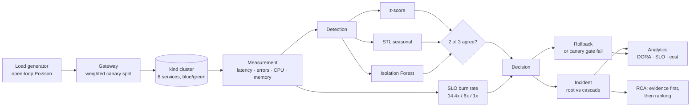

<div align="center">

# OpsForge Nexus

**Reliability analytics and release decisioning for a live microservice fleet.**

It measures six services running on a real Kubernetes cluster, decides whether a release is safe,
prices what each incident cost, and proves its own detection works by breaking things on purpose.

[](https://github.com/IshaanS0112/OpsForge-Nexus/actions/workflows/ci.yml)
[](LICENSE)
[](https://www.python.org)
[](https://react.dev)
[](#tests)

6 services · 3 detection layers · 4 DORA + SLO metric families · 150 tests · one `docker compose up`

[Quick start](#quick-start) · [What it answers](#what-it-answers) · [How it decides](#how-it-decides) · [Measured results](#measured-results) · [Methods](docs/methods.md) · [Architecture](docs/architecture.md)

</div>

---

<div align="center">

</div>

## What it answers

Four questions, each from stored measurements rather than opinion — the same four an engineering
or operations review asks every week:

| Question | What the system computes | Where it comes from |
|---|---|---|
| **Are we shipping safely?** | Release frequency, change failure rate, rollout duration p50/p95 | Every rollout's recorded state history |
| **Are we meeting our promises?** | Availability per service vs its SLO, error budget consumed | Request counts written each 5-second tick |
| **How fast do we react?** | Time to detect, time to restore, what caught each incident first | Incidents, plus chaos drills that know the true fault onset |
| **What did it cost?** | Priced impact per incident and per service, with the inputs stored | Measured bad requests × revenue per request |

`GET /analytics/summary?days=7` returns all four. The Insights screen above is that one call, rendered —
and so is the report, if a terminal is where you work:

```console
$ python3 scripts/report.py --days 1

33% OF ROLLOUTS WERE TAKEN BACK AND 2 OF 6 SERVICES HELD THEIR OBJECTIVE.

DELIVERY
  Releases              2 (2.0/day)
  Rolled back           1
  Change failure rate   33%
  Rollout duration      10.1s median, 40.2s p95

RESPONSE
  Incidents         4 (2 root, 2 cascading)
  Time to restore   7m 55s mean, 7m 59s p95
  Time to detect    2.5s (measured by drills)
  Drills passed     1 of 1
  Caught first by   burn-rate page (3), canary gate (1)

COST
  Estimated impact    $1,133.00
  Costliest service   ledger-svc
```

*(Real output from a run: two releases, one bad canary caught by its gate, one latency drill.)*

## How it works



Everything left of RCA is deterministic code. A language model only ranks causes at the end, over
evidence the system already computed, and a rule-based fallback ranks the same evidence when no key
is configured.

## How it decides

Each one traces to a published source — Wald's sequential test, the SRE Workbook's
multiwindow alerts, STL, Isolation Forest, Kahn's topological sort, DORA's metric
definitions — mapped to its implementation and its test in [`docs/methods.md`](docs/methods.md).

| Decision | Method | Why this one |
|---|---|---|
| Is this canary safe to promote? | Wald's sequential probability ratio test on the canary's own error ratio | It is evaluated every 5 s; a fixed-sample test re-checked that often fails healthy releases far more than its stated rate |
| Is the service burning its budget? | Multiwindow burn-rate alerts, 14.4× / 6× / 1× (Google SRE Workbook) | Long window asks "is it real", short window asks "is it still happening" |
| Is this metric anomalous? | z-score · STL seasonal residual · Isolation Forest, two must agree | Each has a different blind spot; agreement beats raising one threshold |
| Who is actually broken? | Dependency DAG: blast radius, root vs cascade | One root failure should open one incident, not five pages |
| Should we roll back? | FAST_BURN **and** detector consensus **and** not a cascade victim | Rolling back a victim cannot fix its upstream |
| What did it cost? | Measured bad requests beyond baseline × revenue per request | Every input stored with the result, so the number is auditable |

## Quick start

Needs Docker with ~3 GB free. The first run creates the Kubernetes cluster.

```bash
git clone https://github.com/IshaanS0112/OpsForge-Nexus.git
cd OpsForge-Nexus
docker compose up -d --build
```

| | |
|---|---|
| Ops Console | http://localhost:8080 |
| API docs | http://localhost:8000/docs |
| Backend metrics | http://localhost:8000/metrics |

Then drive it:

```bash
./scripts/demo.sh                 # healthy canary, bad canary, chaos drill, RCA, impact
python3 scripts/run_drills.py     # the drill suite; records land in docs/drills/
```

No Docker? `CLUSTER_MODE=simulated` runs the same backend against an in-memory cluster.

**Your own services, not the demo fleet.** Post any service's readings to
`/metrics/ingest-batch` and they go through the same three detector layers, the same
consensus rule and the same incident pipeline as measured traffic:

```bash
curl -X POST localhost:8000/metrics/ingest-batch -H 'content-type: application/json' \
  -d '{"service_name":"my-api","error_rate":0.15,"latency_p95":1400,"cpu_usage":0.9,"memory_usage":0.8,"requests":500}'
```

<div align="center">

</div>

## Measured results

Recorded on the local cluster; full records with timelines in [`docs/drills/`](docs/drills/).

| Injected fault | Service | Detected | By | Recovered | Cascade |
|---|---|---|---|---|---|
| Latency +400 ms | ledger-svc | 5.5 s | burn-rate page | 66.6 s | 3 services |
| Error burst, 50% | inventory-svc | 13.2 s | detector consensus | 69.2 s | 2 services |
| Pod kill, every pod | payments-svc | 11.5 s | burn-rate page | 62.5 s | 2 services |
| Error burst on canary | catalog-svc | 13.7 s | canary gate → rolled back in 13.7 s | 64.9 s | — |

Two findings worth reading: the error burst **never paged** — sixty seconds of half-failing traffic
spends about 1% of an hour's budget, under the 14.4× threshold — which is why the detector layers
exist alongside burn-rate alerts. And the first pod-kill drill **failed**, because those pods still
carried a stale readiness delay; the backend now reconciles drifted Deployments at startup.

## Tests

```bash
cd backend && pip install -r requirements-dev.txt && ruff check . && pytest   # 142
cd frontend && npm ci && npm run typecheck && npm test                        # 8
```

CI also runs a real-cluster smoke test: it creates a kind cluster, ships an unpullable image, a
blue-green release and a canary through all four stages, then injects a fault and checks the cascade
is classified correctly.

## Stack

FastAPI · SQLAlchemy + Alembic · PostgreSQL · Kubernetes (kind) · NumPy · statsmodels · scikit-learn ·
Prometheus · React 19 + TypeScript + Vite · n8n · Docker Compose · LLM ranking via the Anthropic API,
with a deterministic fallback.

## Scope

Honest boundaries, in full in [Scope](docs/architecture.md#scope): one local cluster node, synthetic
traffic, a hand-defined dependency graph, an unsupervised anomaly model that makes no accuracy claim,
a canary split at the gateway rather than in a service mesh, and `revenue_per_request` as a
configurable business parameter.

## License

MIT
